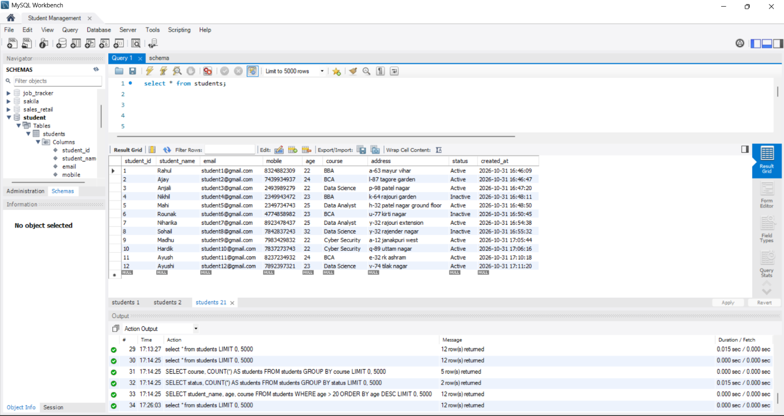
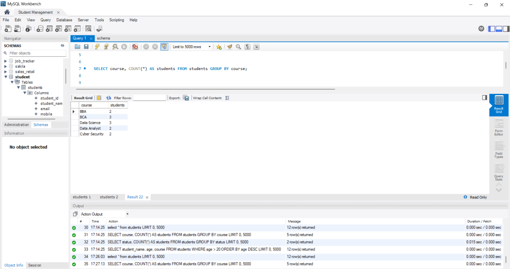
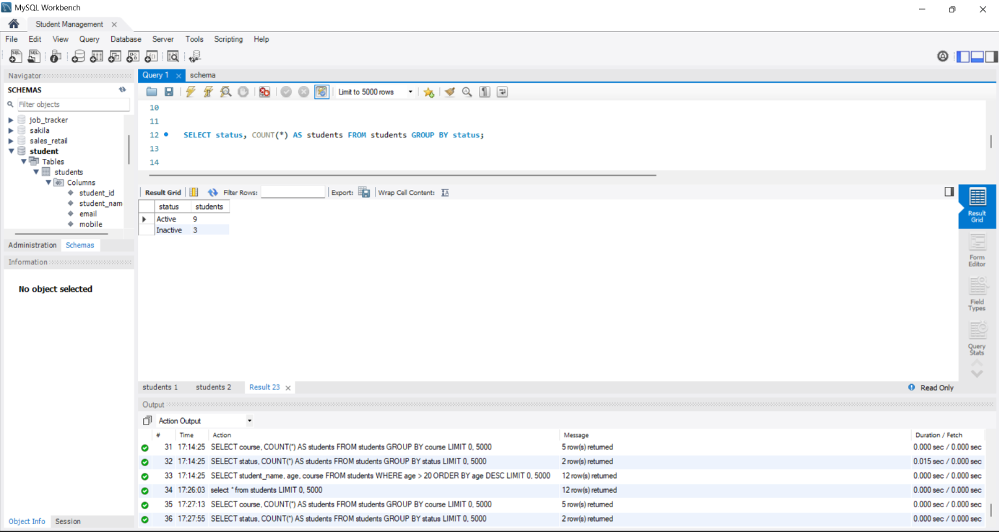
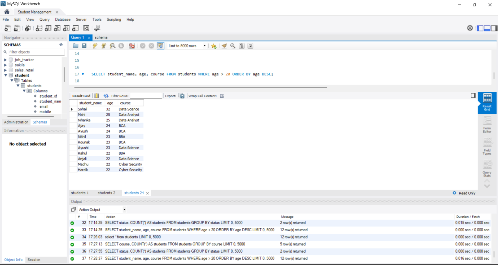

# Student Management System

A desktop app I built with Python and Tkinter to replace paper registration forms. Student details are entered in a form, saved to a MySQL database, and can be viewed in a table or exported to CSV for Excel.

All the data used in the queries below is made-up sample data.

## What it does

- **Registration form** with fields for name, email, mobile, age, course, address and status (Active / Inactive)
- **Input checks** when you click Save:
  - name is required
  - email must look like a real email address
  - mobile must be exactly 10 digits
  - age must be a number
  - a clear error message shows under the form if something is wrong
- **Duplicate check:** the database does not allow the same email or mobile number twice, and the app shows a message when that happens
- **Manage Students window** with a scrollable table of all saved records, a record count, and a Refresh button
- **Export to CSV** button that saves all records with pandas, so the file opens directly in Excel

## Built with

Python, Tkinter, MySQL (`mysql-connector-python`), pandas

## How the code works

Everything is in `student_management.py`.

| Part of the code | What it does |
|---|---|
| `get_connection()` | Opens a connection to the MySQL `Student` database. The password is read from an environment variable, so it is not stored in the code. |
| `validate_email()` | Uses a regular expression to check the email looks like `name@site.com`. |
| `validate_mobile()` | Checks the mobile number is exactly 10 digits. |
| `StudentApp` class | Holds the whole window. |
| `build_ui()` | Draws the form on the left, the buttons, and the title on the right. |
| `save_record()` | Reads the form, runs the checks, and inserts a row into the `students` table. If the email or mobile already exists, it shows a friendly message. |
| `open_manage()` | Opens a second window with the table, the Refresh button and the Export button. |
| `load_table()` | Reads all rows from the `students` table and fills the table in the window. |
| `export_csv()` | Reads the table into a pandas DataFrame and saves it as a CSV file. |

## Queries I ran on the data

After adding sample students through the form, I ran these queries in MySQL Workbench.

**1. All students**
```sql
SELECT * FROM students;
```


**2. Number of students in each course**
```sql
SELECT course, COUNT(*) AS students
FROM students
GROUP BY course;
```


**3. Active vs inactive students**
```sql
SELECT status, COUNT(*) AS students
FROM students
GROUP BY status;
```


**4. Students older than 20, oldest first**
```sql
SELECT student_name, age, course
FROM students
WHERE age > 20
ORDER BY age DESC;
```


## How to run it

1. Install the packages:
   ```
   pip install mysql-connector-python pandas
   ```
2. Open `schema.sql` in MySQL Workbench and run it. This creates the `Student` database and the `students` table.
3. Set your MySQL password as an environment variable so it is not stored in the code. On Windows, run this in Command Prompt, then reopen it:
   ```
   setx DB_PASSWORD "your_mysql_password"
   ```
4. Start the app:
   ```
   python student_management.py
   ```

## What it does not do yet

- Records can be added and viewed, but not edited or deleted from the app.
- The checks run when you press Save, not while typing.

## Files

```
mysql-student-app/
|-- README.md
|-- student_management.py
|-- schema.sql
|-- screenshots/
```

Ameek Singh Panesar
